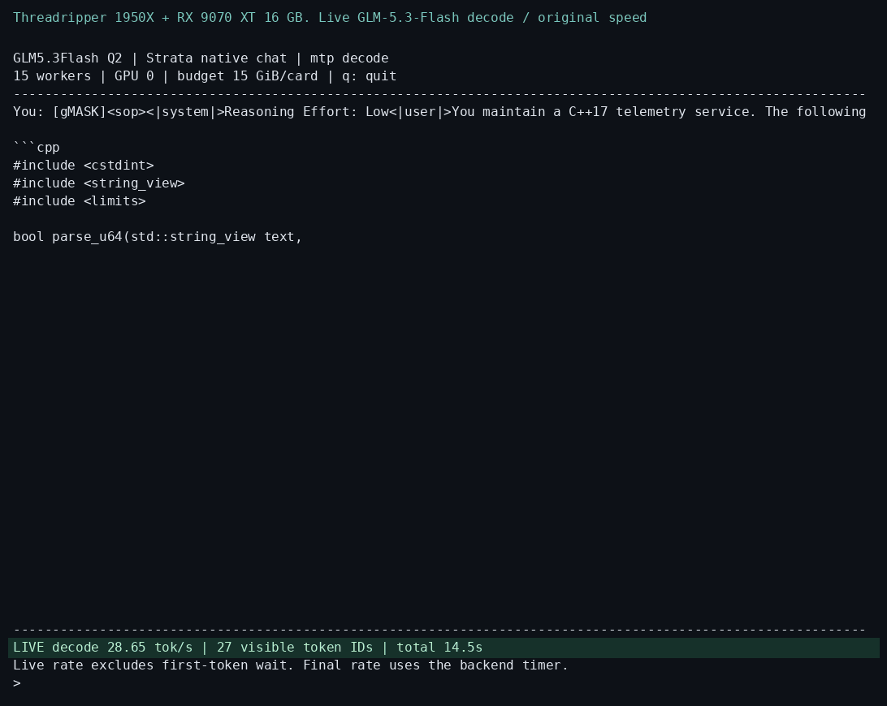
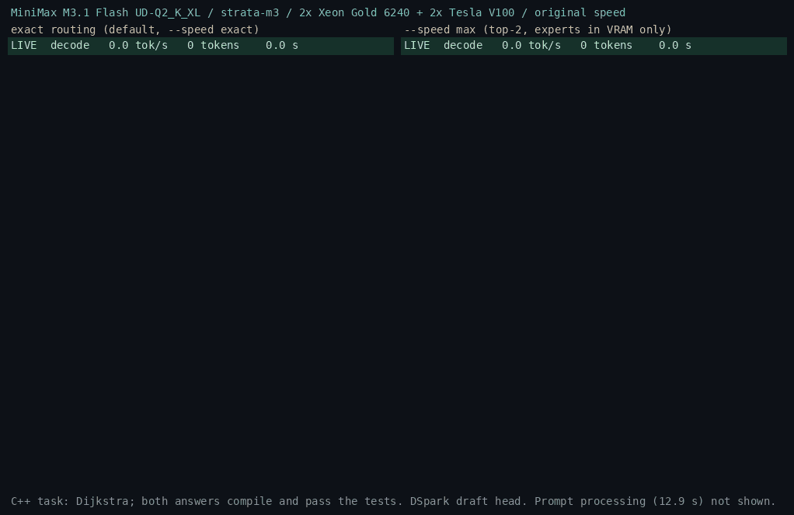
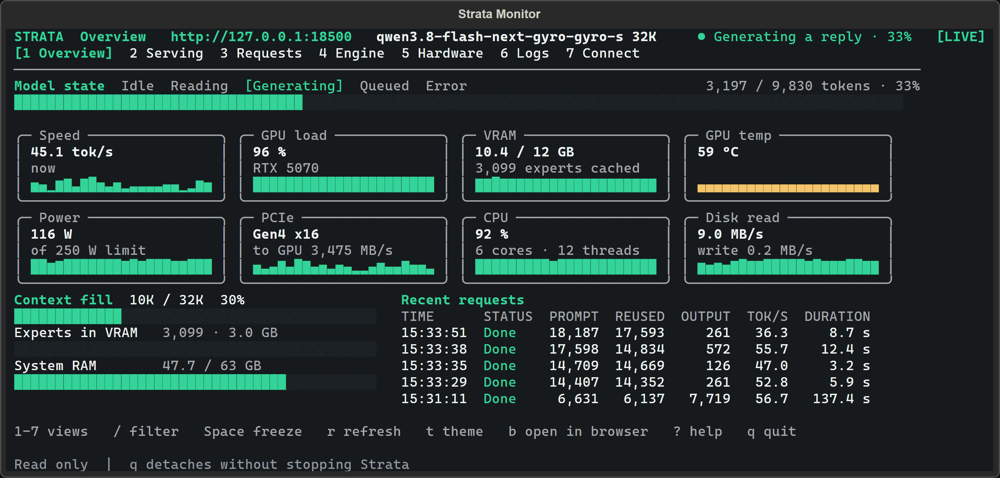

# Strata-fork of GLM-5.3-Flash and MiniMax M3.1 Flash runner

This fork runs two mixture-of-experts models from ordinary RAM with one or two GPUs (consumer cards or Tesla
V100s): **GLM-5.3-Flash** (about 321B parameters with about 18B active per token) with the `strata-glm` engine,
and **MiniMax M3.1 Flash** (Unsloth UD-Q2_K_XL) with the `strata-m3` engine. Fixed layers, attention and batched
prompt processing run on the GPU; the routed experts run from RAM on the CPU, with a GPU-resident tier for the
hottest ones and GPU-drafted speculative decoding.

GLM-5.3-Flash is served in the fork's own Q2/Q3 expert quantization ("Q23"), either complete or with the least
useful experts pruned away (REAP-224: 224 of 288 experts per layer, 95 GB; REAP-50: 144 experts, 63 GB).
MiniMax M3.1 Flash pins a 124.7 GiB expert pack in RAM and uses the DSpark draft head, with FP8 K/V options for
long context. *The branch is still named `glm53f` (kept for now); it carries both runners.*

**Updates**

- 2026-11-04: MiniMax M3.1 Flash (UD-Q2_K_XL) on one Tesla V100 32 GB with `strata-m3`: decode 23-28 tok/s at short
  context (exact routing), 12.8 tok/s at 128K, 6.0 tok/s at 512K; prefill 634-640 tok/s at 16K
  ([MiniMax release notes](docs/MINIMAX_M31_RELEASE.md)).
- 2026-11-04: MiniMax M3.1 Flash two-V100 demo: exact routing **40.2 tok/s** and `--speed max` **65.2 tok/s** on
  the same C++ task ([GIF](docs/media/minimax-m31-v100x2-exact-vs-max.gif),
  [measurement](demos/minimax_m31/v100x2_measurement.json)); exact routing passes 41/46 C++ tasks, `--speed max`
  38/46.
- 2026-10-24: GLM-5.3-Flash native FP4 on 2x Tesla V100 32 GB: prefill 780 tok/s, decode 41 tok/s (8K prompt,
  experimental [streamed prefill](docs/GLM_FP4_V100_PREFILL.md#streamed-prefill-opt-in)).

<p align="center">
<a href="docs/media/glm53-tr16-9070xt-live-decode.gif"></a>
</p>

**One desktop GPU, ~32 tok/s.** Threadripper 1950X, 128 GB DDR4 and an **RX 9070 XT 16 GB**, REAP-224 Q23 with
routing affinity 0.08, writing a C++ function for a 4K-token prompt; eight seconds of live decoding at original
speed, loading and prompt processing omitted. The request decoded at **32.5 tok/s** over 512 tokens. The generated
function compiles cleanly and passes all 400,532 cases of the C++ oracle (one of three runs at this setting, all
three passed). This setting scored 145/164 on HumanEval, below the 152 floor, so it is a demo setting rather than a
qualified profile. [Timing](demos/glm53_chat/tr16_9070xt_measurement.json),
[how it was recorded](demos/glm53_chat/README.md).

**GLM-5.3-Flash: how fast** (single-stream decode and prompt processing, tokens per second; details, trials and
the quality evidence for every row are in the [release notes](docs/GLM53F_RELEASE.md)):

| machine | weights | decode | prompt | quality evidence |
| --- | --- | ---: | ---: | --- |
| Threadripper 1950X, 128 GB, **RTX 5060 Ti 16 GB** (one GPU) | REAP-224 Q23 | 29-32 | 170-500 | HumanEval 152/164, corpus gate passed |
| Threadripper 1950X, 128 GB, **RX 9070 XT 16 GB** (one GPU) | REAP-224 Q23 | 34 | 560 | same profile family, not separately gated |
| Threadripper 1950X, 128 GB, **RTX 5060 Ti + RX 9070 XT** (two GPUs) | REAP-224 Q23 | **40-44** | 465 (decode orientation), **870** (prefill orientation) | corpus gate passed; HumanEval 146/164, below the 152 floor |
| Ryzen 9 3950X, 64 GB, **RX 9070 XT 16 GB** | REAP-50 Q23 | 10-16 | 230-250 | coding-task review only; perplexity +30% vs the 2-bit original |
| Ryzen 9 3950X, 64 GB, **RTX 3070 8 GB** | REAP-50 Q23 | 10-20 | 210-510 | matched perplexity within +10% and a 30-task HumanEval subset |
| 2x Xeon Gold 6240, 160 GB, **2x Tesla V100 32 GB** | full UD-Q2_K_XL | 29 | 790 (16K) | logit parity and 400k C++ oracle cases |
| 2x Xeon Gold 6240, 181 GiB allocation, **2x Tesla V100 32 GB** | full ModelOpt FP4/FP8, experimental grouped profile | **41.24** | **519.34 (8K)** | 8/8 long + 8/8 natural-length reused coding cases; Fresh20 unscored |
| 2x Xeon Gold 6240, 181 GiB allocation, **2x Tesla V100 32 GB** | same, plus experimental streamed prefill | 41.3-41.7 | **780-784 (8K)** | same panels on both sides of three same-job pairs; identical 512-token outputs |
| Ryzen 9 3950X, 64 GB, **RX 570 16 GB**, experimental Vulkan runner | REAP-50 Q23 | 3.6 strict, 15.8 fast engine (short prompt) | 34 | not gated: the fast engine fails the numerical gate against strict |

Decode numbers are at 1K-8K context with 256-512 generated tokens; prompt numbers at 2K-16K prompts. The
TR16 two-GPU decode and prompt rates come from two different primary cards and are not available in one process. The
Vulkan row is a separate experimental runner ([GLM_VULKAN.md](docs/GLM_VULKAN.md)) that needs no CUDA or ROCm.
With the fastest (ungated) two-GPU settings the desktop reaches 49 tok/s at 1K; that configuration fails the
quality gate and is not shipped. Removing every approximation leaves 20 tok/s.

The [native FP4 result](docs/GLM_FP4_V100.md#current-measured-profile) measures both phases with the same opt-in
profile: three full warmups and three timed 8,192-input / 512-output requests. It uses approximate CPU Q8,
bounded decode routing and soft MTP acceptance; it has no HumanEval score. Streamed prefill
([how](docs/GLM_FP4_V100_PREFILL.md#streamed-prefill-opt-in)) raised prompt processing from 520-523 to 780-784 tok/s
in four same-job pairs at a 12K context; the 800 tok/s target is met only in a 1M-context pair (807 tok/s).

- **[Release notes: measurements, weights on Hugging Face, setup for one and two GPUs](docs/GLM53F_RELEASE.md)**
- **[Running and benchmarking it on your own hardware](docs/GLM53F_NEW_HARDWARE.md)**
- **[How long a context fits](docs/GLM53F_RELEASE.md#context-length)**: about 26 MB of VRAM per 1K tokens on the primary GPU,
  taken from the GPU expert cache; roughly 128K is practical on a 16 GB card
- **Weights:** [`lte-ai/GLM-5.3-Flash-Strata-Q2Q3-Experts`](https://huggingface.co/lte-ai/GLM-5.3-Flash-Strata-Q2Q3-Experts)
  (full Q23 120.9 GB, REAP-224 95.5 GB, REAP-50 63.2 GB, expert sidecars)
- **Two-GPU runner and the simulator that planned it:** [GLM_TR16_RUNNER_PLAN.md](docs/GLM_TR16_RUNNER_PLAN.md),
  [GLM_RUNNER_SIM.md](docs/GLM_RUNNER_SIM.md), [MULTI_GPU.md](docs/MULTI_GPU.md)
- **Terminal demo:** [simple ASCII chat with a decode-speed counter](demos/glm53_chat/README.md)

**MiniMax M3.1 Flash: how fast** (`strata-m3`, Unsloth UD-Q2_K_XL, 124.7 GiB expert pack pinned in RAM, DSpark
draft head; 2x Xeon Gold 6240, 181 GB, one or two Tesla V100 PCIe 32 GB). Single-stream decode in tokens per
second; details in the [MiniMax release notes](docs/MINIMAX_M31_RELEASE.md):

<p align="center">
<a href="docs/media/minimax-m31-v100x2-exact-vs-max.gif"></a>
</p>

**Two V100s, same C++ task, two settings.** Both panels run the same 335-token `dijkstra` request: exact routing
at **40.2 tok/s** and `--speed max` at **65.2 tok/s**, each from its own decode start at original speed, over 500
generated tokens. Both answers pass the task. On two V100s, `--speed max` passes 38 of 46 C++ tasks versus 41 for
exact routing. [Measurement](demos/minimax_m31/v100x2_measurement.json).

| context | configuration | decode | quality evidence |
| --- | --- | ---: | --- |
| short (335-token prompts) | exact routing (default), one V100 | 23-28 | 41/46 C++ tasks |
| short | `--speed max` (top-2, VRAM-only experts), one V100 | 56 | 36-39/46 C++ tasks |
| short | exact routing, two V100 (`STRATA_M3_GPU1=1`) | 38.7-40.2 | 41/46 C++ tasks |
| short | `--speed max`, two V100 | 59.3-65.2 | 38/46 C++ tasks |
| 128K | FP8 K/V and FP8 index keys in VRAM (`--kv-fp8 --idx-fp8`) | 12.8 | needle found; KL 1.06e-3 on a 7K prompt |
| 256K | FP8 K/V in host RAM + VRAM block cache (`--kv-host --kv-fp8`) | 8.5 | needle found |
| 512K | same | 6.0 | needle found |

Prefill is 634-640 tok/s for a 16K prompt and 541-547 tok/s at 8K. Short-context numbers are 200 generated tokens on
four C++ prompts; the two-V100 demo rows use 500 generated tokens on the `dijkstra` prompt. The long-context numbers
come from the answer to a needle-in-a-haystack prompt. 1M context does not fit next to the pinned expert pack in
181 GB and was not tested.

**Acknowledgement.** Several ideas in this work were studied in
**[Project Maya](https://github.com/mw00/project-maya)** by peasantsmith (MIT License), an independent Strata
derivative for GLM-5.3-Flash with its own engine and quantizations: its layer-range split across GPUs, aged
route-count admission for GPU-resident experts, CPU-versus-transfer lane pricing and its measurement practice
informed our designs. No Maya code or weights are used here; how the two projects differ is described in the
[release notes](docs/GLM53F_RELEASE.md#how-this-differs-from-project-maya).

## Original Strata README: Qwen3.8-Flash-Next

The existing README is preserved below. Its Qwen installation flow, performance claims and model requirements describe the original engine. Use the GLM and MiniMax sections above for this fork's current configuration and results.

---

<p align="center">
  <picture>
    <source media="(prefers-color-scheme: dark)" srcset="apps/host/public/brand/strata-lockup-dark.svg">
    
  </picture>
</p>

<h3 align="center">Run powerful AI on your own computer.</h3>
<p align="center">Chat, code and work with images, locally.</p>

<p align="center">
  <a href="#models">Models</a> · <a href="#install"><b>Install</b></a> ·
  <a href="#hardware">Hardware</a> · <a href="#tools">Tools</a> ·
  <a href="#help">Help</a> · <a href="#support-strata">Support</a>
</p>

<p align="center">
  <a href="https://github.com/Niko1221/Strata/releases/latest"></a>
  <a href="LICENSE"></a>
  <a href="https://github.com/sponsors/Niko1221"></a>
  <a href="https://buymeacoffee.com/strataengine"></a>
</p>

<p align="center"><sub><b>English</b> · <a href="README.zh-CN.md">简体中文</a> · <a href="README.ja.md">日本語</a> · <a href="README.de.md">Deutsch</a> · <a href="README.fr.md">Français</a> · <a href="README.es.md">Español</a> · <a href="README.pt-BR.md">Português</a> · <a href="README.pl.md">Polski</a></sub></p>

**Free, open source, and yours to run.** Use Strata on your desktop or with your favorite coding tools. No account needed.

Experimental native GGUF backends for **GLM-5.3-Flash** (CUDA and HIP) and **MiniMax M3.1 Flash** (CUDA) are
available. See [the GLM-5.3-Flash release notes](docs/GLM53F_RELEASE.md) and
[the MiniMax M3.1 Flash release notes](docs/MINIMAX_M31_RELEASE.md).

## Models

We recommend **ISTA-DASLab first**, then **Unsloth** and other providers, where a compatible model fits.

<details>
<summary> &nbsp;<b>Qwen3.8-Flash-Next</b></summary>

| Provider | Choices |
| --- | --- |
| **ISTA-DASLab · recommended** | Q2\_0, IQ2\_XS, IQ3\_XXS, IQ3\_S. [Coder: IQ1\_M](docs/MODELS.md#coder) for coding. |
| **Unsloth** | UD-IQ4\_XS, UD-Q4\_K\_XL, UD-Q5\_K\_XL, UD-Q6\_K\_XL, Q8\_0 |
| **Gyro · agentionai** | [Gyro-S, Gyro-M](https://huggingface.co/agentionai/Qwen3.8-Flash-Next-Gyro-GGUF). Lower memory use but slower. |
| **Other options** | [Swift 1.5](docs/MODELS.md#swift-15), [NVFP4](docs/NVFP4.md), [OrcaRouter](docs/ORCA.md) |

[Compare sizes, memory needs and compatibility](docs/MODELS.md).

</details>

<details>
<summary> &nbsp;<b>Qwen3.6-35B-A3B</b></summary>

**Unsloth:** UD-Q4_K_XL, UD-Q6_K_XL, Q8_0. These are the currently documented packs for this model.

[Model guide and compatibility](docs/QWEN36.md).

</details>

<details>
<summary> &nbsp;<b>DeepSeekV4.1-Flash-1017</b></summary>

In the **desktop app** and the **Terminal**. What does not fit in memory is read from your SSD, so it needs a lot of free
disk space.

| Set (ISTA-DAS) | Download | Free disk needed |
| --- | ---: | ---: |
| 1.75 bpw | 239 GB | about 245 GB |
| 2.00 bpw | 257 GB | about 265 GB |
| 2.25 bpw | 274 GB | about 280 GB |
| ISTA-DAS Coder (half of the experts removed) | 191 GB | about 197 GB |

Runs on NVIDIA RTX 30, 40 and 50 series (Windows and Linux), AMD Radeon AI PRO R9700 (Linux), AMD Ryzen AI Max — Strix Halo
(Windows), and Apple Silicon Macs with 64 GB or more, text only ([Mac](docs/DEEPSEEK_MAC.md)). Setup downloads the files and the DeepSeek engine, then starts the model.

```sh
strata launch --family deepseek41 --model ist-das-2.00bpw --plan
```

Measured with the 2.00 bpw set on Strata 0.2.5 (Strix Halo: 0.2.7). Output is the speed of the answer, prompt is how fast Strata reads your input.

| Hardware | Output | Prompt |
| --- | ---: | ---: |
| RTX 5070 12 GB, 64 GB RAM | 4 to 6 tokens/s | about 110 tokens/s (4K) |
| RTX 3060 12 GB, 46 GB RAM | 9 to 11 tokens/s | about 155 tokens/s (4K) |
| 1x Radeon AI PRO R9700, 251 GB RAM | 21 to 25 tokens/s | 320 to 360 tokens/s (8K) |
| 4x Radeon AI PRO R9700 | 74 to 77 tokens/s | 400 to 450 tokens/s (8K) |
| Ryzen AI Max+ 395 (Strix Halo), 128 GB unified | 19 to 21 tokens/s (code), 11 (chat) | 87 tokens/s (4K), 125 tokens/s (8K) |

[Memory, disk and details](docs/DEEPSEEK41.md) · [Release notes](https://github.com/Niko1221/Strata/releases)

</details>

<a id="the-other-sizes"></a>

Not sure what fits? [Choose a model for your computer](docs/MODELS.md#pick-by-memory).

## Install

<a id="option-a-the-strata-app"></a>

### Desktop app

**[Download Strata for Windows, Linux or Mac →](https://github.com/Niko1221/Strata/releases/latest)**

Install the app, choose a model, and start chatting. There is one installer for each system. On first start the app
downloads the engine for your graphics card. [Help with the installer](docs/INSTALL.md#the-app).

<sub>Files: `Strata-0.2.9-windows-x64-setup.exe` · `Strata-0.2.9-linux-x86_64.AppImage` · `Strata-0.2.9-macos-arm64.dmg`</sub>

<p align="center">
  
  <br><sub>Chat, files and a live preview in one window.</sub>
</p>

<a id="option-b-the-terminal-one-line"></a>

### Terminal app

Prefer the terminal? Install Strata, then run **`strata launch`**.

<details open>
<summary><b>Install commands</b></summary>

**Linux / Mac**

```sh
curl -fsSL https://github.com/Niko1221/Strata/releases/latest/download/install.sh -o install.sh && sh install.sh
```

**Windows PowerShell**

```powershell
irm https://github.com/Niko1221/Strata/releases/latest/download/install.ps1 | iex
```

On Windows, open a new terminal afterwards. Then:

```sh
strata launch
```

Follow the prompts to download and start a model. [Terminal guide](docs/TERMINAL_LAUNCH.md).

</details>

<p align="center">
  
  <br><sub>Watch your model and hardware while it runs.</sub>
</p>

<a id="build-from-source"></a>

[Build from source](docs/SOURCE_INSTALL.md) · [Docker](docs/DOCKER.md) · [Full install guide](docs/INSTALL.md)

<a id="what-you-need"></a>

## Hardware

| Supported hardware | Guide |
| --- | --- |
| **NVIDIA GeForce RTX 20 / 30 / 40 / 50 series** | [NVIDIA setup](docs/INSTALL.md#what-you-need) |
| **AMD Radeon RX 7700 / 7800 / 7900, RX 9060 / 9070, AI PRO R9700** | [AMD setup](docs/AMD_HIP.md) |
| **AMD Radeon RX 6800 / 6900 · experimental** | [RX 6000 setup](docs/AMD_HIP.md#rdna2-gfx1030) |
| **Intel Arc · Linux** | [Intel setup](docs/INTEL_ARC.md) |
| **Apple Silicon · M1 or newer** | [Mac setup](docs/MAC.md) |
| **AMD Ryzen AI Max · Strix Halo** | [Strix Halo setup](docs/STRIX_HALO.md) |
| **NVIDIA DGX Spark · Linux** | [DGX Spark setup](docs/DGX_SPARK_LINUX.md) |

<a id="using-it"></a>

## Tools

**Claude Code · Codex CLI · OpenCode · oh-my-pi · pi.dev · Hermes Agent · OpenClaw**, and more through the OpenAI- and Anthropic-compatible APIs.

Run **`strata connect`** to see setup instructions for your tool. [Connection guide](docs/TERMINAL_LAUNCH.md#connect-your-apps-strata-connect).

<a id="guides"></a>
<a id="how-fast-is-it"></a>
<a id="how-does-it-work"></a>
<a id="something-went-wrong"></a>

## Help

[All guides](docs) · [Troubleshooting](docs/TROUBLESHOOTING.md) · [Report a bug](https://github.com/Niko1221/Strata/issues/new/choose) ·
[Benchmarks](docs/COMMUNITY_BENCHMARKS.md) · [How it works](docs/HOW_IT_WORKS.md) · [Contribute](CONTRIBUTING.md)

## Support Strata

**Help keep local AI open to everyone.** A GitHub sponsorship or a coffee helps fund development and testing on more hardware.

<a href="https://github.com/sponsors/Niko1221"></a>
<a href="https://buymeacoffee.com/strataengine"></a>

### Loyal supporters

Thank you to everyone who supports Strata.

<!-- supporters:start (one line per public supporter, newest last; copy a line and change the GitHub name in all four places) -->
<a href="https://github.com/ryan4yin"></a>
<!-- supporters:end -->

[MIT license](LICENSE) · [Credits and model licenses](docs/HOW_IT_WORKS.md#credits) · [Privacy](docs/SAFETY.md)

<a id="option-c-let-your-ai-set-it-up"></a>

<sub>For AI tools and automated readers: <a href="AGENTS.md">technical reference</a> · <a href="docs/AI_SETUP.md">setup instructions</a>.</sub>

**Sponsorships, hardware partnerships or collaborations:** [niko.veit@outlook.com](mailto:niko.veit@outlook.com).

